
<a href="/" style="display:inline-block; border:1.5px solid var(--global-text-color,#333); border-radius:4px; padding:4px 12px; font-weight:bold; font-size:0.9em; color:inherit; text-decoration:none;">EN</a>

你好，我是 **吴金骏 (WU, Jinjun)**，目前就读于 **[香港科技大学 (HKUST)](https://hkust.edu.hk/)** 工学院 **[计算机科学与工程系](https://cse.hkust.edu.hk/)** 的 **计算机科学**专业 大二年级。MBTI 是 **ISTP**。课余时间喜欢看综艺、玩游戏（原神、跳一跳、纪念碑谷），以及用 vibe coding 做一些（没什么用的）东西。:)

我目前的研究和学习兴趣为概率、图论与机器学习理论。

理论计算机科学
机器学习
图论&图算法
概率统计

下载简历 <a href="/files/CV-EN.pdf" style="display:inline-block; border:1.5px solid var(--global-text-color,#333); border-radius:4px; padding:4px 14px; font-weight:bold; font-size:0.9em; color:inherit; text-decoration:none; margin-right:6px;">EN</a> <a href="/files/CV-CN.pdf" style="display:inline-block; border:1.5px solid var(--global-text-color,#333); border-radius:4px; padding:4px 14px; font-weight:bold; font-size:0.9em; color:inherit; text-decoration:none;">中</a>

## 教育背景

**计算机科学（工学学士）**  
*香港科技大学*2025年9月 – 至今
GPA: **3.99/4.3**（HKUST 前 2%）  
主修GPA: **4.195/4.3**

  
<strong>课程绩点</strong>

  

    <table style="border:none; margin:8px 0 0; font-size:1em; width:100%;">
      <tr>
        <td style="border:none; padding:0.25em 12px 0.25em 0; vertical-align:top; white-space:nowrap;"><strong>COMP1023</strong></td>
        <td style="border:none; padding:0.25em 12px 0.25em 0; vertical-align:top;">Python 程序设计</td>
        <td style="border:none; padding:0.25em 12px 0.25em 0; vertical-align:top; text-align:right; white-space:nowrap;">95.20</td>
        <td style="border:none; padding:0.25em 12px 0.25em 0; vertical-align:top; text-align:right; white-space:nowrap;">A+</td>
        <td style="border:none; padding:0.25em 0; vertical-align:top; text-align:right; white-space:nowrap;">2025 秋季</td>
      </tr>
      <tr>
        <td style="border:none; padding:0.25em 12px 0.25em 0; vertical-align:top; white-space:nowrap;"><strong>COMP2011</strong></td>
        <td style="border:none; padding:0.25em 12px 0.25em 0; vertical-align:top;">C++ 程序设计</td>
        <td style="border:none; padding:0.25em 12px 0.25em 0; vertical-align:top; text-align:right; white-space:nowrap;">95.14</td>
        <td style="border:none; padding:0.25em 12px 0.25em 0; vertical-align:top; text-align:right; white-space:nowrap;">A+</td>
        <td style="border:none; padding:0.25em 0; vertical-align:top; text-align:right; white-space:nowrap;">2026 春季</td>
      </tr>
      <tr>
        <td style="border:none; padding:0.25em 12px 0.25em 0; vertical-align:top; white-space:nowrap;"><strong>COMP2211</strong></td>
        <td style="border:none; padding:0.25em 12px 0.25em 0; vertical-align:top;">人工智能导论</td>
        <td style="border:none; padding:0.25em 12px 0.25em 0; vertical-align:top; text-align:right; white-space:nowrap;">91.31</td>
        <td style="border:none; padding:0.25em 12px 0.25em 0; vertical-align:top; text-align:right; white-space:nowrap;">A+</td>
        <td style="border:none; padding:0.25em 0; vertical-align:top; text-align:right; white-space:nowrap;">2026 春季</td>
      </tr>
      <tr>
        <td style="border:none; padding:0.25em 12px 0.25em 0; vertical-align:top; white-space:nowrap;"><strong>COMP2711</strong></td>
        <td style="border:none; padding:0.25em 12px 0.25em 0; vertical-align:top;">离散数学</td>
        <td style="border:none; padding:0.25em 12px 0.25em 0; vertical-align:top; text-align:right; white-space:nowrap;">93.0</td>
        <td style="border:none; padding:0.25em 12px 0.25em 0; vertical-align:top; text-align:right; white-space:nowrap;">A</td>
        <td style="border:none; padding:0.25em 0; vertical-align:top; text-align:right; white-space:nowrap;">2026 春季</td>
      </tr>
      <tr>
        <td style="border:none; padding:0.25em 12px 0.25em 0; vertical-align:top; white-space:nowrap;"><strong>MATH1013</strong></td>
        <td style="border:none; padding:0.25em 12px 0.25em 0; vertical-align:top;">微积分 I</td>
        <td style="border:none; padding:0.25em 12px 0.25em 0; vertical-align:top; text-align:right; white-space:nowrap;">93.68</td>
        <td style="border:none; padding:0.25em 12px 0.25em 0; vertical-align:top; text-align:right; white-space:nowrap;">A+</td>
        <td style="border:none; padding:0.25em 0; vertical-align:top; text-align:right; white-space:nowrap;">2025 秋季</td>
      </tr>
      <tr>
        <td style="border:none; padding:0.25em 12px 0.25em 0; vertical-align:top; white-space:nowrap;"><strong>MATH1014</strong></td>
        <td style="border:none; padding:0.25em 12px 0.25em 0; vertical-align:top;">微积分 II</td>
        <td style="border:none; padding:0.25em 12px 0.25em 0; vertical-align:top; text-align:right; white-space:nowrap;">92.45</td>
        <td style="border:none; padding:0.25em 12px 0.25em 0; vertical-align:top; text-align:right; white-space:nowrap;">A</td>
        <td style="border:none; padding:0.25em 0; vertical-align:top; text-align:right; white-space:nowrap;">2026 春季</td>
      </tr>
    </table>
  

## 荣誉与奖项

- **工程学院 院长荣誉名单（Dean's List）**，HKUST — 2025-26 秋季、2025-26 春季
- **本科生继续学习奖学金计划（University's Scholarship Scheme for Continuing Undergraduate Students）**（HKD 40,000，2026）

## 技能

**编程语言:** Python, C++, C  
**人工智能框架:** Scikit-Learn, Keras, TensorFlow, PyTorch  
**数据处理与可视化:** NumPy, Pandas, Matplotlib  
**操作系统:** Linux  
**排版:** LaTeX  
**生产力工具:** Claude Code, Codex, Trae  
**语言:** 普通话（母语），英语（IELTS 7.0）

## 实习经历

### 雅思助教 — QULEDA 乐达文化
*2026年7月 – 2026年8月*

- 负责批改学生作业并提供详细反馈
- 一对一英语口语辅导
- 制作Reading Explorer F, 1-4册听力练习音频

## 项目 & 比赛

### EdgeHealth-ML：端侧多模态人体活动识别
*2026年6月*  
**工具:** Python, PyTorch, torchvision, Claude Code

- 设计了双分支多模态融合架构：视觉分支使用 MobileNetV3-Small 提取 STFT 频谱特征；IMU 分支使用 3层 1D-CNN 处理原始 6 通道加速度计+陀螺仪信号。特征通过拼接 + 2层 MLP（含 Dropout）进行融合
- 在 UCI HAR 数据集（30位受试者，6种活动）上评估，动态活动测试准确率达 87.6%（步行 100%，上下楼梯 96%）

### Kaggle 竞赛: 天体分类 Stellar Class Classification
*2026年5月*  
**工具:** Python, NumPy, Pandas, Scikit-Learn, PyTorch

- 参加 Kaggle 天体分类竞赛（Playground Series S6E6），从 12 维光度数据预测恒星 / 星系 / 类星体（QSO）三类，官方指标为平衡准确率（balanced accuracy）。构建了从经典基线（从零编写的 Decision Stump、KNN、K-means、梯度提升树）到深度模型（MLP、RNN、LSTM、Transformer、条件 GAN）的完整 notebook，并加入颜色指数特征工程与类别权重
- 通过加权软投票集成（blend, don't vote）融合各模型，最终在私有排行榜（private leaderboard）上达到 **96.3% 的平衡准确率**（较此前 94% 的 KNN 基线有明显提升）。Notebook：[Stellar-Classification-zh.ipynb](/files/Stellar-Classification-zh.ipynb)

  
<strong>训练图（训练证明）</strong>

  

  <h4 style="margin:0.8em 0 0.4em;">数据与预处理</h4>
  

    <figure style="margin:0;">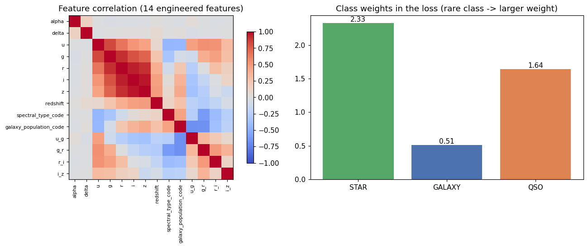<figcaption style="font-size:0.85em; text-align:center; margin-top:4px;">特征相关性矩阵</figcaption></figure>
    <figure style="margin:0;">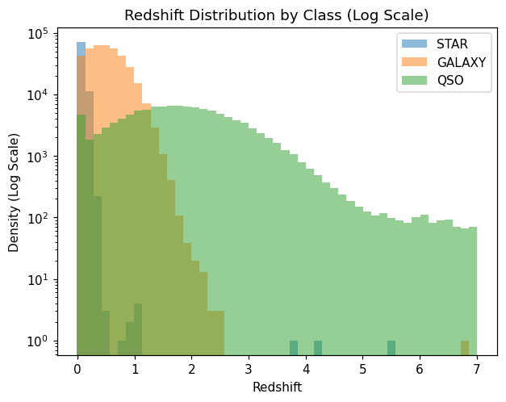<figcaption style="font-size:0.85em; text-align:center; margin-top:4px;">红移分布（按类别）</figcaption></figure>
  

  <h4 style="margin:0.8em 0 0.4em;">经典模型</h4>
  

    <figure style="margin:0;">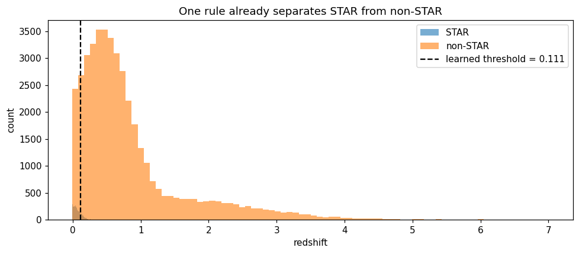<figcaption style="font-size:0.85em; text-align:center; margin-top:4px;">决策桩阈值</figcaption></figure>
    <figure style="margin:0;">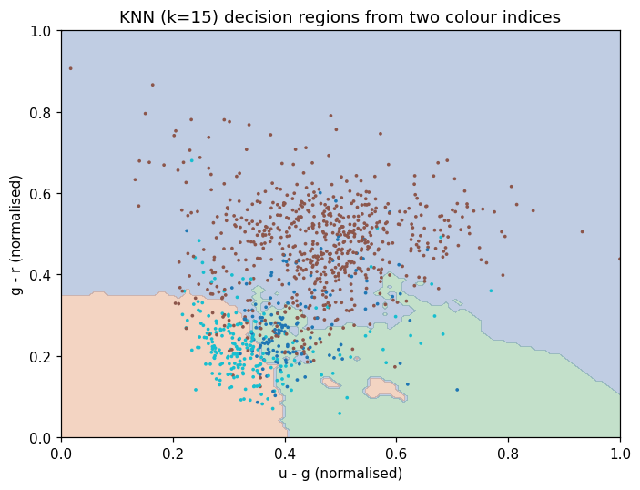<figcaption style="font-size:0.85em; text-align:center; margin-top:4px;">k-近邻</figcaption></figure>
    <figure style="margin:0;">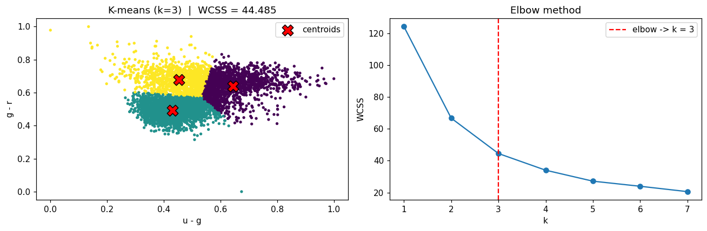<figcaption style="font-size:0.85em; text-align:center; margin-top:4px;">k-means 聚类</figcaption></figure>
    <figure style="margin:0;">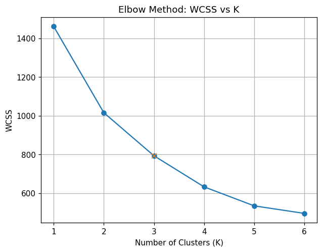<figcaption style="font-size:0.85em; text-align:center; margin-top:4px;">k-means 肘部法则 (WCSS)</figcaption></figure>
    <figure style="margin:0;">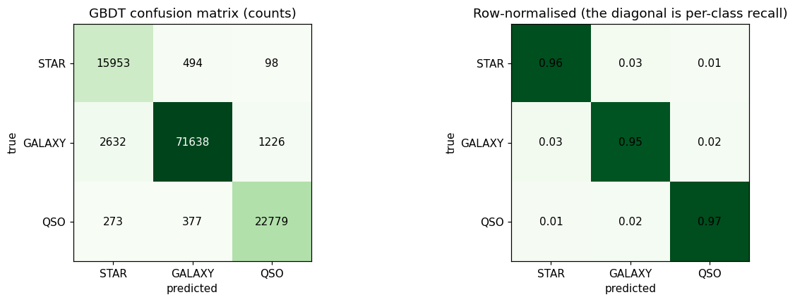<figcaption style="font-size:0.85em; text-align:center; margin-top:4px;">梯度提升树</figcaption></figure>
  

  <h4 style="margin:0.8em 0 0.4em;">深度模型</h4>
  

    <figure style="margin:0;">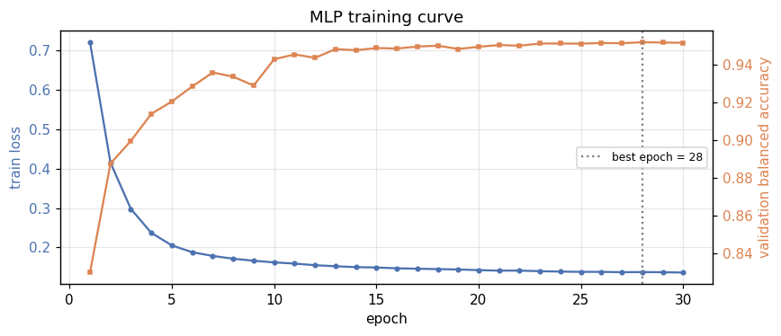<figcaption style="font-size:0.85em; text-align:center; margin-top:4px;">MLP 预测分布</figcaption></figure>
    <figure style="margin:0;">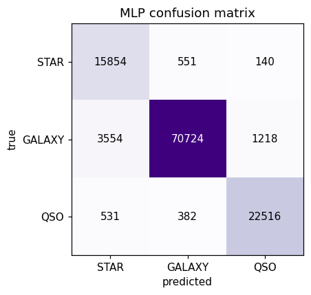<figcaption style="font-size:0.85em; text-align:center; margin-top:4px;">MLP 混淆矩阵</figcaption></figure>
    <figure style="margin:0;">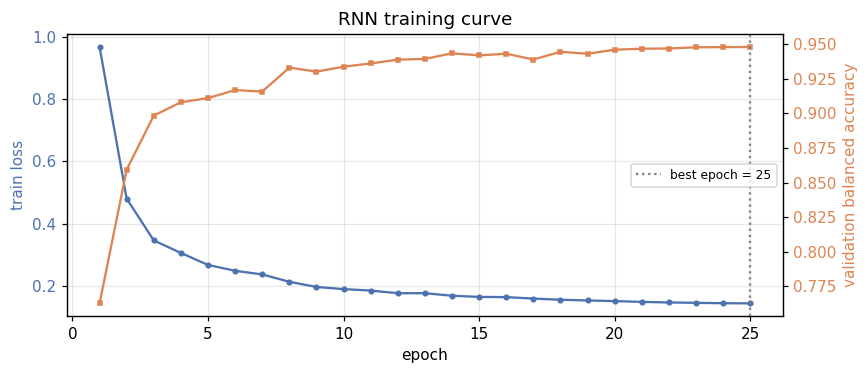<figcaption style="font-size:0.85em; text-align:center; margin-top:4px;">RNN 预测分布</figcaption></figure>
    <figure style="margin:0;">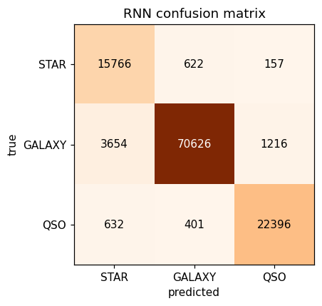<figcaption style="font-size:0.85em; text-align:center; margin-top:4px;">RNN 混淆矩阵</figcaption></figure>
    <figure style="margin:0;">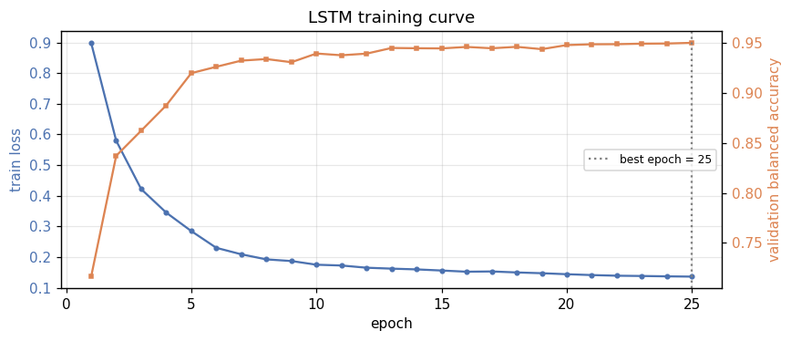<figcaption style="font-size:0.85em; text-align:center; margin-top:4px;">LSTM 预测分布</figcaption></figure>
    <figure style="margin:0;">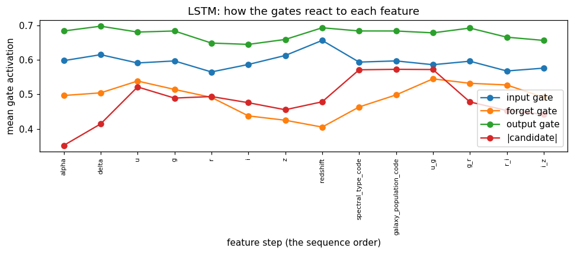<figcaption style="font-size:0.85em; text-align:center; margin-top:4px;">LSTM 分类准确率</figcaption></figure>
    <figure style="margin:0;">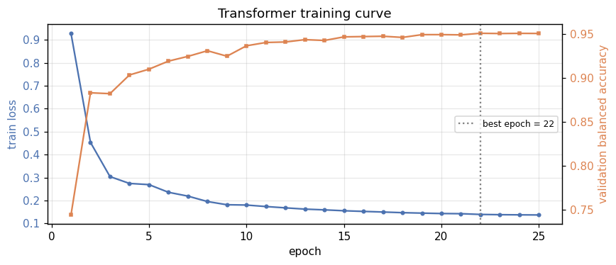<figcaption style="font-size:0.85em; text-align:center; margin-top:4px;">Transformer 预测分布</figcaption></figure>
    <figure style="margin:0;">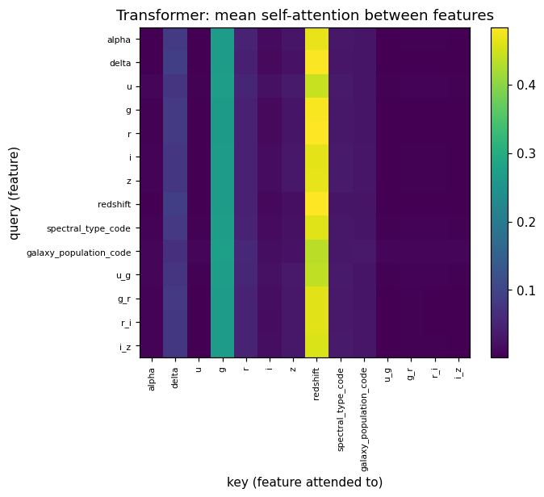<figcaption style="font-size:0.85em; text-align:center; margin-top:4px;">Transformer 注意力</figcaption></figure>
  

  <h4 style="margin:0.8em 0 0.4em;">生成模型（GAN）</h4>
  

    <figure style="margin:0;">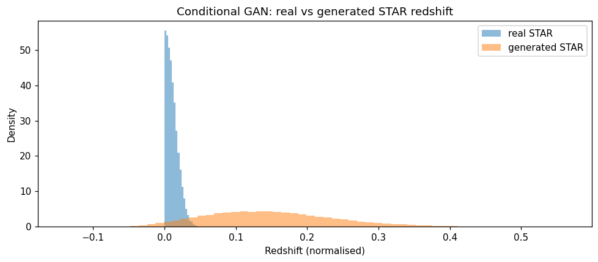<figcaption style="font-size:0.85em; text-align:center; margin-top:4px;">GAN 生成样本</figcaption></figure>
    <figure style="margin:0;">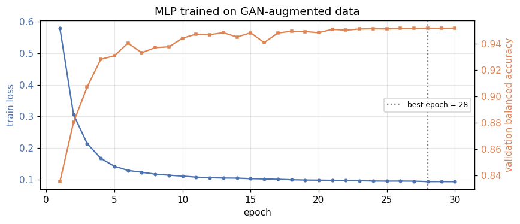<figcaption style="font-size:0.85em; text-align:center; margin-top:4px;">GAN 判别器损失</figcaption></figure>
    <figure style="margin:0;">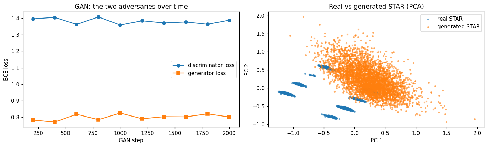<figcaption style="font-size:0.85em; text-align:center; margin-top:4px;">GAN 训练</figcaption></figure>
  

  <h4 style="margin:0.8em 0 0.4em;">分析与集成</h4>
  

    <figure style="margin:0;">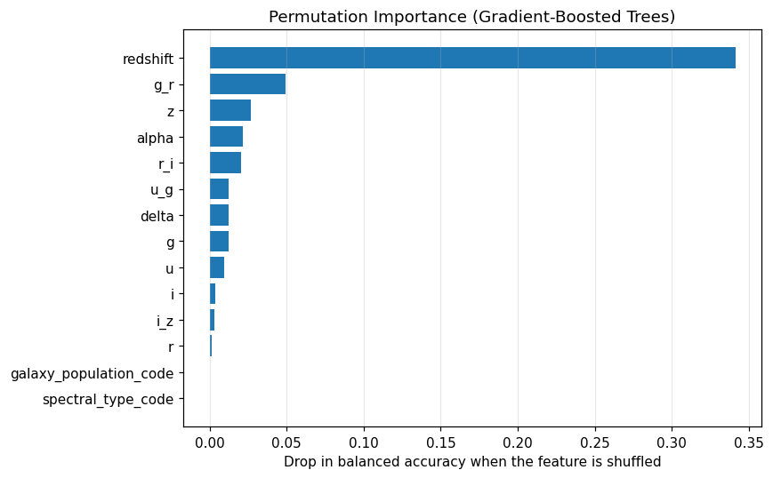<figcaption style="font-size:0.85em; text-align:center; margin-top:4px;">排列重要性</figcaption></figure>
    <figure style="margin:0;">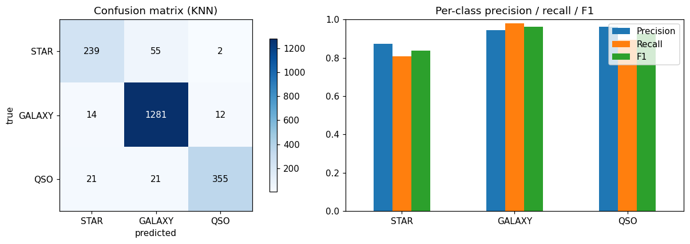<figcaption style="font-size:0.85em; text-align:center; margin-top:4px;">最终预测</figcaption></figure>
    <figure style="margin:0;">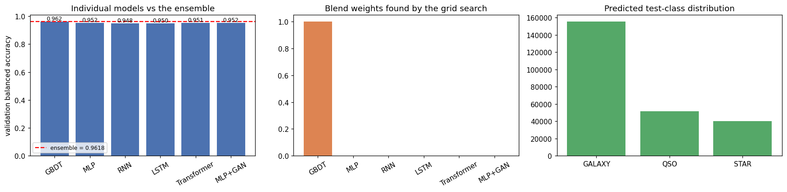<figcaption style="font-size:0.85em; text-align:center; margin-top:4px;">最终集成结果</figcaption></figure>
  

  

### COMP3511 编程作业: Myshell — 简化版 Linux Shell
*2026年9月*  
**工具:** C, POSIX

- 实现经典 fork-exec 命令执行引擎：父进程 fork() 生成子进程后用 execvp() 加载外部程序，wait() 回收子进程，杜绝僵尸进程
- 实现 I/O 重定向与多阶段管道调度：支持 `<` `>` 重定向任意混排与 N-1 段 pipe() 串联
- exit/cd 作为内建命令在父进程执行，注册 SIGINT 处理支持 Ctrl-C 中断；gcc -std=c99 -pedantic -Wall -Wextra 零告警编译通过，10 个公开 + 6 个隐藏用例全部通过

### [Agent Breaker](https://play.lakera.ai/) — Lakera
*2026年7月*  
**分数: 1787 · 排行榜: 前 200（前 2%）**

- 参加了 Agent Breaker 挑战赛——一个 GenAI 安全竞赛，目标是通过 prompt injection 攻击绕过防御并操控底层 LLM，跨多个级别黑掉真实世界的 AI 智能体
- 攻击各类 GenAI 应用以窃取敏感数据、提取系统指令并操控 LLM 行为；获得 1787 分，全球排名前 200（前 2%）

### Skill Writer Skill
**工具:** PowerShell

一个用于编写其他 Claude Code 技能的元工具 — 服务于技能编写工作流

## 计划中的学习 & 项目
**项目**：

- **满满情绪价值系统** — 提供满满情绪价值的系统
- **[Graphcode](https://justinlinkk.github.io/projects/graph-code/)** — 面向大型多文件软件系统的图原生、人机协同架构 IDE（合作项目）

**学习中**：
- 概率论与数理统计
- 高级数据结构与算法设计
- PyTorch 语法与强化学习基础
